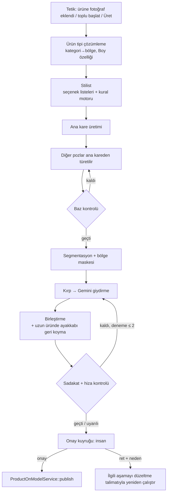

# Creative — Mokap Giydirme (Kilitli Baz + Maske + Birleştirme) — Tasarım ve Uygulama Planı

- **Tarih:** 2026-10-05
- **Kapsam:** `Modules/Creative` — Ürün Giydirme hattı (`ProductOnModelService`, `GenerateOnModelJob`, `TryonController`, `CreativeTryon.vue`), ret nedenleri ve günlük ret raporu.
- **Durum (2026-10-06):** **Faz 0, Faz 1 ve Faz 2 uygulandı ve commit edildi.** Arayüz (Faz 4) yok; akış `php artisan creative:mockup {ürün} --mannequin= [--garment=] [--sync]` komutuyla başlar, sonuçlar mevcut Ürün Giydirme onay listesine düşer. Ayrıntılı durum ve sıradaki adımlar: aşağıdaki "Uygulama durumu ve devir notu" bölümü.

## Bağlam: çözülen sorun

Bugünkü akış her ürün × poz için mankeni Gemini ile **yeniden pozluyor** (`MannequinPoseComposer`), sonra ürünü giydiriyor. Manken her seferinde yeniden çizildiği için aynı ürünün pozları arasında kıyafet ve aksesuar tutarsız çıkıyor: bir pozda kısa kollu tişört ve kolye yok, ötekinde uzun kol ve kolye var, ışık farklı (canlı örnek: ürün #10 Kot Etek, giydirme #4 ve #8). 2026-10-05'te eklenen "kombin tamamlama" (`creative.ai.tryon_styling`) kombini her üretimde yeniden seçtirdiği için bu tutarsızlığı artırır.

**Mokap yaklaşımı:** manken + kombin + poz bir kez **baz görsel** olarak üretilir ve kilitlenir. Ürün yalnızca bir **maske** içinde giydirilir ve sonuç baz görselle **birleştirilir**. Maske dışındaki her piksel birebir baz görselden gelir; yüz, saç, ayakkabı ve aksesuar pozlar arasında değişemez.

## Kullanıcı kararları (2026-10-05 oturumu)

1. **Tamamen otomatik.** Ürün veya kategori başına manuel çalışma yok. Kombin onayı veya baz görsel onayı gibi ara insan adımları yok; bunların yerine otomatik kontroller ve otomatik yeniden üretim var.
2. **Son yayın onayı her zaman insanda.** Bugünkü gibi hiçbir AI görseli onaysız ürün galerisine girmez. Otomatik yayın seçeneği yok.
3. **Ürüne özel kombin.** Ortak bir baz kütüphanesi yerine her ürün kendi kombinini ve pozlarını alır; bir ürünün tüm pozlarında kombin aynıdır, ürünler arasında farklıdır.
4. **Kombin parçalarını AI uydurur** (gerçek ürünlerden oluşmaz). Veri modelinde ileride gerçek ürüne bağlanabilecek alan bırakılır.
5. **Birden fazla manken** kullanılabilir.
6. **Sabit poz havuzu;** ürün, havuzdan kendisine uygun pozları alır.
7. **Uzun ürünler (maksi etek, geniş paça) çok;** ilk sürümde desteklenmeli.
8. **Model:** giydirme Gemini (`gemini-3.1-flash-image`) ile kırp-giydir-birleştir. fal fashn mokap hattında kullanılmaz (çıktı ~971 px, büyütülünce denim yapay görünüyor); mevcut hatta kalır.
9. **Mevcut giydirmelere dokunulmaz;** referans olarak kalırlar.
10. **Ret raporları kalır** ve mokap aşamalarına göre yeniden düzenlenir.

## Pilot bulguları (tasarımı belirleyenler)

| Bulgu | Tasarıma etkisi |
|---|---|
| Ana kareden türetilen pozlar kombin ve aksesuarı korudu | Baz üretimi: önce ana kare, diğer pozlar ondan türetilir |
| Gemini kırpılmış girdiyle hizayı bozmadı (fark 1,4–4/255, kaydırma 0 px) | Kırp-giydir-birleştir; hiza ölçümü otomatik kontrol olarak kalır |
| "Üst içeride olsun" talimatı ana karede iki kez tutmadı | Talimata güvenilmez; maskeye bel üstü **tuck şeridi** dahil edilir |
| Uzun üründe ayakkabı maske içinde + sonradan bazdan geri koyma çalıştı | Uzun alt / uzun takım için **ayakkabı geri koyma** adımı |
| Takımda tek adım ≈ iki adım (önce alt, sonra üst), iki adım 2× maliyet | Takım varsayılan tek adım; iki adım yalnız sadakat kontrolünden kalınca |
| Model üründe olmayan detay ekledi (maksiye kat dikişi) | Sadakat kontrolü + bulguyu düzeltme talimatı yapıp **otomatik yeniden deneme** |
| Sadakat kontrolü gürültülü (önden pozda sırt detayını eksik saydı) | Kontrol insan onayının yerine geçmez; uyarı + yeniden deneme tetikleyicisi; poz yönünü bilir |
| Serbest metin stilist tekdüze (beyaz tişört + kanvas) ve boyu yanlış (maksi → midi) | Stilist **sabit seçenek listeleri + kural motoru**; boy ürün özelliğinden |
| Baz ana karesi çıplak ayaklı üretildi | **Baz kontrolü** (ayakkabı var mı, kombin pozlar arası aynı mı) + onaylı kareden yeniden türetme |
| Keskinleştirme model dokusunu bozdu | Birleştirmede keskinleştirme yok; yalnız eksik kumlanma eşitlenir |
| Segmentasyon (`mattmdjaga/segformer_b2_clothes`) bu pozlarda elle düzeltme gerektirmedi | Maske tamamen otomatik; elle düzeltme ekranı ilk sürümde yok. **Ama bu model üretimde kullanılamaz** (bkz. Lisans kontrolü) |

## Lisans kontrolü (2026-10-05) — segmentasyon katmanı değişiyor

Pilotta kullanılan `mattmdjaga/segformer_b2_clothes` **ticari kullanıma uygun değil**:

- Model kartı lisans olarak NVlabs SegFormer lisansını gösteriyor; `config.json` → `_name_or_path: nvidia/mit-b2` (NVIDIA ağırlıklarından türetilmiş).
- **NVIDIA Source Code License for SegFormer §3.3:** "The Work and any derivative works thereof only may be used or intended for use non-commercially … 'non-commercially' means for research or evaluation purposes only." Kısıt türetilmiş modelleri de kapsıyor.
- Eğitim verisi ATR (`mattmdjaga/human_parsing_dataset`) — veri seti sayfasında lisans belirtilmemiş; ATR/LIP/CIHP gibi insan ayrıştırma veri setleri genelde yalnız araştırma amaçlıdır.
- Projenin kendi kodunda bu model hiç kullanılmamış; yalnız pilot betikleri (değerlendirme amaçlı — lisans kapsamında) kullandı. Sunucudaki HF önbelleğinde duruyor; üretime taşınmayacak.

**Yerine (hepsi Apache 2.0, ticari kullanıma açık):**

| Bileşen | Görev | Lisans |
|---|---|---|
| MediaPipe Selfie Multiclass (256×256) | Piksel sınıfı: arka plan, saç, vücut teni, yüz teni, kıyafet, diğer (aksesuar) | Apache 2.0 (model kartı) |
| MediaPipe Pose Landmarker (BlazePose GHUM) | Kalça/bel, bilek, ayak bileği, topuk, ayak ucu noktaları → üst/alt ayrımı, el ve ayakkabı bölgeleri | Apache 2.0 (model kartı) |
| SAM 2 / 2.1 (Meta) | Noktalar/kutularla tam çözünürlükte keskin maske (ayakkabı, el, giysi) | Apache 2.0 (kod ve ağırlıklar) |
| OWLv2 (projede zaten var, Faz G.3b) | Gerekirse metinle kutu ("shoe", "skirt") → SAM2'ye istem | Apache 2.0 |

Kurulum: "kıyafet" sınıfı poz noktalarıyla üst/alt diye bölünür; eller bilek + el noktalarından, ayakkabılar ayak noktalarından SAM2 ile çıkarılır; SAM2 kenarları tam çözünürlükte keskinleştirir. MediaPipe çok sınıflı modeli selfie için tasarlandı ve 256×256 girdi alıyor; tam boy görselde kaba sonuç verebilir, kenar kalitesini SAM2 taşıyacak. **Bu yığının maske kalitesi Faz 0'da küçük bir pilotla ölçülmeli** (aynı 12+ baz görselde segformer maskeleriyle karşılaştırma).

## Mimari

### Bölge tipleri

| Bölge | Örnek kategoriler | Baz görseldeki yer tutucu | Maske | Önde kalanlar (bazdan) |
|---|---|---|---|---|
| `bottom` (mini/diz) | Etek, şort | Gri bisiklet şortu, üst içeride | Bel −%1 → çorap üst kenarı, yatay pay %30 + tuck şeridi (%5) | Saç, üst (şerit hariç), kollar/eller, çorap+ayakkabı |
| `bottom_long` (midi/maksi) | Maksi etek, pantolon | Bilekte biten gri tayt | Bel → görsel altı, yatay pay %45, ayakkabı dahil + tuck şeridi | Saç, üst (şerit hariç), kollar/eller; **ayakkabı birleştirmeden sonra geri konur** |
| `top` | Bluz, tişört, gömlek | Gri kısa kollu tişört | Boyun → bel +%8, kollar dahil | Saç, yüz |
| `one_piece` | Elbise, tulum | Gri atlet + şort/tayt | Üst ∪ alt (boya göre) | Saç, yüz; uzunsa ayakkabı geri konur |
| `set` | Takım | Gri tişört + şort/tayt | Üst ∪ alt (boya göre) | Saç, yüz; uzunsa ayakkabı geri konur |

İlk sürümde **kapsam dışı:** dış giyim (ceket/mont başka bir kıyafetin üstüne giyilir; ayrı bir `outerwear` bölgesi ve katman mantığı gerekir), ayakkabı, çanta ve aksesuar ürünleri. Bu kategoriler eşleştirmede "mokap dışı" kalır ve mevcut hattan geçer.

### Kırp-giydir-birleştir

1. Maske kutusu %8–10 payla genişletilir ve **tam 3:4** orana getirilir (Gemini çıktısı 3:4; oran bozulursa yeniden ölçekleme deforme eder).
2. Kırpılmış görüntü + ürün fotoğrafı (+ varsa detay görselleri) bölge tipine özel talimatla Gemini'ye gider.
3. Çıktı kırpma boyutuna yeniden ölçeklenir; maske 5 px yumuşatılır, önde kalanlar 1,2 px yumuşak kenarla bazdan en üste konur.
4. Uzun ürünlerde birleşik sonuç yeniden segmente edilir. Hem çıktıda hem bazda "ayakkabı" olan pikseller bazdan geri gelir; kumaşın ayakkabıyı örttüğü yerde çıktı kalır.
5. Eksik kumlanma eşitlenir. Keskinleştirme yapılmaz.

### Otomatik kontroller

| Kontrol | Aşama | Yöntem | Sonuç |
|---|---|---|---|
| Ayakkabı var mı | Baz | Segmentasyon: ayakkabı pikseli > eşik | Kalırsa kare onaylı başka pozdan yeniden türetilir |
| Kombin pozlar arası aynı mı | Baz | Gemini görüntü analizi (ana kare ↔ poz yan yana, JSON) | Kalırsa yeniden türet (en fazla 2) |
| Bel bölgesi / tuck | Baz | Gerek yok; tuck şeridi yapısal olarak çözer | — |
| Hiza | Birleştirme | Maske dışı ortalama fark (0–255) | > 8 → yeniden giydir |
| Maske dışı korunma | Birleştirme | Değişmeyen piksel oranı | < %99,9 → hata (yazılım hatası) |
| Ürün sadakati | Birleştirme | Ürün ↔ sonuç yan yana, Gemini JSON `pass/warn/fail` + bulgular; poz yönü (ön/yan/arka) talimatta | `fail` → bulgular düzeltme talimatı olarak yeniden giydir (en fazla 2); hâlâ `fail` → onaya **uyarılı** düşer |
| Renk tonu | Birleştirme | Mevcut `ColorAuditorContract` (Faz Q) | Uyarı; renk kilidi ayrıca değerlendirilecek |

Kontrol sonuçları sonuç satırına (`qa` JSON) yazılır ve onay ekranında rozet olarak görünür. Hiçbir kontrol insan onayını atlamaz.

### Stilist

- Girdi: ürün fotoğrafı, ürün tipi (bölge + boy, **AI tahmini değil** — aşağıya bkz.), manken (yaş/cinsiyet), poz havuzu (etiketli).
- Çıktı: seçenek **anahtarları** (serbest metin değil). Örnek: `top: fitted_knit_tee`, `color: peach`, `footwear: mary_jane`, `socks: white_ankle`, `accessory: scrunchie`, `poses: [walking_stride, standing_three_qtr]`, `reasoning_tr`.
- Kural motoru (saf PHP, DB'siz, AI'sız; `GarmentIdentityRuleEngine` / `CreativeRulesEngine` disiplini): anahtarları doğrular, uyumsuzları eler (ör. üst/takım ürününde göğüste aksesuar yok; `bottom` için üst içeride; `bottom_long` için uygun ayakkabı), çeşitlilik kuralı uygular (aynı kategoride son N üründe aynı ayakkabı+üst kombinasyonu tekrarlanmaz), sonra İngilizce kombin cümlesini seçeneklerin `prompt_en` alanlarından **kurar**. AI'nın ürettiği metin doğrudan prompt'a girmez (proje AI standardı: versiyonlu + güven + enum + kural motoru).
- `prompt_version` alanı taşınır; prompt değişince elle artırılır.

### Ürün tipi çözümleme

1. Ürün kategorisi → bölge eşleştirmesi (ayarlar; tek seferlik). Eşleşme yoksa ürün mokap dışı kalır, mevcut hattan geçer.
2. Boy: ürünün "Boy" özelliğinden (Ürün Ayarları › Özellikler; Bagisto'ya giden özellik sistemi, `products.attributes`). Özellik henüz yoksa eklenmeli: `mini | diz | midi | maksi`.
3. Boy boşsa **son çare** AI tahmini kullanılır, sonuç satırında "boy tahmin edildi" uyarısı taşır.

## Veri modeli (yeni migration'lar — `Modules/Creative/database/migrations/`)

CLAUDE.md disiplini: ileri-tarihli migration, gerçek `down()`, Postgres'e özel kısımlar `getConnection()` korumalı (Pest sqlite'ta koşar), sonrasında `schema:audit`.

- **`creative_mockup_outfits`** — ürüne özel kombin: `product_id`, `mannequin_id`, `region`, `length`, `length_source` (`attribute|ai`), `pieces` (JSON, seçenek anahtarları), `outfit_sentence`, `poses` (JSON), `reasoning_tr`, `stylist_prompt_version`, `status`, `meta`. İleride gerçek ürün bağlamak için `pieces[*].product_id` alanı boş bırakılabilir.
- **`creative_mockup_bases`** — kilitli baz görseller: `outfit_id`, `pose_id`, `derived_from_base_id` (ana kare için null), `image_path`, `labels_path` (segmentasyon `.npy`/PNG), `masks` (JSON: bölge/önde kalan/ayakkabı maskesi yolları + kırpma kutusu), `qa` (JSON), `status` (`queued|generating|ready|failed`), `attempts`, `generation_token`.
- **`creative_tryon_results`** (mevcut tabloya ek): `pipeline` (`legacy|mockup`, varsayılan `legacy`), `mockup_base_id` (nullable FK), `qa` (JSON: kontrol sonuçları, deneme sayısı, bulgular). Mevcut onay → yayın akışı, ret sohbeti ve kapak aynen kullanılır.
- **`creative_stylist_options`** — seçenek listeleri: `kind` (`top|bottom|footwear|socks|accessory|color`), `key`, `label_tr`, `prompt_en`, `tags` (JSON: üslup, mevsim, resmiyet, uygun bölgeler, yaş aralığı), `is_active`, `sort_order`. Seeder ile başlangıç listesi gelir.
- **`creative_poses`** (mevcut tabloya ek): `mockup_regions` (JSON: uygun bölgeler), `requires` (JSON: ör. `pockets`), `view` (`front|side|back|three_quarter` — sadakat kontrolü için).
- **`creative_category_regions`** — `category_id` → `region` (veya Setting grubu; ayarlar sayfasının yapısına göre karar verilecek).
- **`rejection_reasons`** (mevcut tabloya ek): `stage` (`base|stylist|mask|tryon|composite`) — ret nedeni hangi aşamaya karşılık geliyor.

Not: `creative_mockup_*` tabloları log niteliğinde büyümez (ürün başına birkaç satır); `Prunable` gerekmez. Ara dosyalar (kırpma, ham model çıktısı) geçicidir ve iş sonunda silinir; diskte kalıcı olanlar baz görsel, maskeler ve staged sonuçtur.

## Servisler ve işler

`laravel-service` kuralları: çok metotlu orkestratör, constructor DI, domain exception, repository yok, DTO yok (Creative'in mevcut `*Request` taşıyıcıları — `MannequinPoseRequest`, `CloseupRequest` — gibi AI sürücü girdileri hariç).

| Sınıf | Görev |
|---|---|
| `MockupPipelineService` | Orkestratör: ürün → kombin → bazlar → giydirmeler; aşama durumlarını ilerletir, işleri zincirler |
| `MockupProductTypeResolver` | Kategori → bölge, Boy özelliği → `length`; mokap dışıysa `null` |
| `MockupStylistService` + `MockupStylistRuleEngine` | Gemini analizi (seçenek anahtarları) + saf kural motoru |
| `MockupBaseService` | Ana kare + türetme (`GeminiClient`), baz kontrolü, yeniden türetme |
| `MockupMaskService` | Python segmentasyon + bölge maskesi + kırpma kutusu (subprocess) |
| `MockupTryOnService` | Kırp → Gemini → birleştir → (uzunsa) ayakkabı geri koy; `ProductOnModelService::persistStaged()` ile staged dosya |
| `MockupFidelityChecker` | Ürün ↔ sonuç karşılaştırması, hiza; düzeltme talimatı üretir |
| İşler | `GenerateMockupOutfitJob` → `GenerateMockupBaseJob` (poz başına) → `GenerateMockupTryonJob` (poz başına). Mevcut `GenerateOnModelJob` `pipeline=mockup` satırları `MockupTryOnService`'e yönlendirir; ret sohbeti ve yeniden üretim aynı kuyruktan geçer |

**Python** (`Modules/Creative/python/`, mevcut `.venv` — torch + transformers kurulu): `mockup_segment.py` (MediaPipe Multiclass + Pose + SAM2 → etiket haritası; segformer KULLANILMAZ — lisans), `mockup_mask.py` (bölge maskeleri, kırpma kutusu), `mockup_composite.py` (birleştirme, ayakkabı geri koyma, ölçümler). PHP'den mevcut `Python*` sürücüleri gibi subprocess ile çağrılır, JSON döner.

**Kuyruk notu:** torch süreçleri kuyruk worker'ının belleğine yüklenmemeli; her çağrı ayrı Python süreci olmalı. Sunucuda worker'ın daha önce OOM ile öldüğü biliniyor ve `numprocs=1` giydirme işlerini sıraya diziyor. Toplu tetiklemede bunun ölçülmesi gerekiyor.

## Arayüz

- **Ürün Giydirme sayfası:** Mokap hattı varsayılan olur. Seçilen ürün için "Üret" mokap akışını başlatır; mokap dışı kategoride mevcut akış çalışır. Toplu başlatma: "fotoğrafı olup giydirmesi olmayan ürünler". Galeride sonuçların üzerinde kontrol rozetleri (geçti / uyarı + bulgu metni) ve kombin özeti (stilistin Türkçe gerekçesi) görünür.
- **Otomatik tetik:** ürüne ilk fotoğraf eklendiğinde (event dinleyicisi) mokap akışı kuyruğa alınır. Ayarlardan açılıp kapatılır.
- **Creative ayarları** (modül ayar sayfası deseni — sekme satırının sağındaki çark, kendi yetkisi): kategori → bölge eşleştirmesi, stilist seçenek listeleri, poz etiketleri (`mockup_regions`, `requires`, `view`), otomatik tetik, yeniden deneme sayısı.
- **Onay ekranı:** mevcut onayla/reddet akışı aynen; ret nedenleri aşama gruplarıyla gelir. Ret, nedenin aşamasını düzeltme talimatıyla yeniden çalıştırır (bugünkü "AI ile Konuş → uygula" mekanizmasının otomatik hali).
- Arayüz Oz kit ile kurulur; yeni tablolar `OzTable` + toplu seçim (proje kuralı).

Yetki: yeni izin gerekip gerekmediği uygulama başında `laravel-authorization` akışıyla kullanıcıya sorulacak (mevcut adaylar: `creative.asset.manage` üretim, `creative.approve` onay).

## Ret raporları

- **Nedenler aşamaya bağlanır.** Mevcut 21 nedenden yüz kaynaklı olanlar (Göz, Burun, Ağız / Gülüş, Saç, Ten / Cilt, Vücut oranı, Işık, Duruş / Poz, Arka plan) **"Baz görsel / manken"** grubuna taşınır. Ürün odaklılar (kol boyu, yaka, fermuar/düğme, kumaş, baskı/desen, boy/kesim, renk, dikiş, ölçek, ön/arka) `tryon` aşamasında kalır.
- **Yeni nedenler:** "Üründe olmayan detay eklenmiş" (`tryon`), "Birleştirme izi / kenar" (`composite`), "El veya ayakkabı bozuk" (`composite`), "Kombin ürüne uymuyor" (`stylist`), "Ürün tipi / boy yanlış algılanmış" (`stylist`).
- Değişiklik migration ile yapılır (seeder canlı DB'yi kendiliğinden düzeltmez).
- **Günlük rapor (`creative:review-report`) genişler:** aşama bazında ret dağılımı; **otomatik kontrol ↔ insan kararı** karşılaştırması (kontrol geçti ama reddedildi = kaçan hata; kontrol kaldı ama onaylandı = yanlış alarm); stilist kombini bazında ret oranı.
- Canlı DB'de şu an reddedilmiş giydirme yok (2026-09-26 sıfırlaması); geçmiş veri kaybı söz konusu değil.

## Mevcut sistemle ilişki

- **Eski hat (`pipeline=legacy`)** mokap dışı kategoriler için çalışmaya devam eder; mevcut giydirmeler (#3–#11) değişmez.
- **`creative.ai.tryon_styling` (kombin tamamlama)** mokapla gereksizleşir: kombin baz görselde kilitlenir. Mokap oturduktan sonra bayrak ve `MannequinPosePromptBuilder::stylingLines()` kaldırılır.
- **Gemini/fal.ai seçici** (`TryOnDriverResolver`) eski hatta kalır; mokap hattı Gemini kullanır.
- **Yakın planlar** (`ProductCloseupService`, `shot` kolonu): mokap sonuçlarında önce yüksek çözünürlüklü birleşik görselden **kırp + büyüt** (AI'sız, birebir) denenir; AI ile yakın plan yalnız özel kadrajlar için kalır.

## Uygulama aşamaları

| Faz | İçerik | Bitiş ölçütü |
|---|---|---|
| **0 — Ön koşullar** | ~~Segformer lisansı~~ → **kontrol edildi, uygun değil**. Apache 2.0 yığınla (MediaPipe Multiclass + Pose + SAM2) maske pilotu; gerçek ürün fotoğraflarıyla 3–5 ürünlük sadakat teyidi | Yeni maske yığını pilot maskeleriyle eşdeğer; gerçek fotoğrafta sadakat kabul edildi |
| **1 — Çekirdek hat** | Migration'lar, Python modülleri, `MockupProductTypeResolver`, basit (kuralsız) stilist, baz üretimi, maske, kırp-giydir-birleştir, ayakkabı geri koyma; tek ürünü uçtan uca çalıştıran artisan komutu; onay kuyruğuna düşme | Bir ürünün tüm pozları komutla üretilip mevcut onay ekranında onaylanabiliyor |
| **2 — Otomatik kontroller** | Baz kontrolü, hiza, sadakat kontrolü + düzeltmeli yeniden deneme, `qa` JSON, onayda rozetler | Kontroller kayıtlı; `fail` sonuçlar otomatik yeniden deneniyor |
| **3 — Stilist kural motoru** | `creative_stylist_options` + seeder, kural motoru, çeşitlilik kuralı, Boy özelliği | Stilist yalnız seçenek anahtarı üretiyor; aynı kategoride tekrar sınırı çalışıyor |
| **4 — Otomasyon ve arayüz** | Ürün Giydirme sayfası mokap modu, toplu ve otomatik tetik, ayarlar sayfası (kategori eşleştirme, seçenekler, poz etiketleri) | Ürüne fotoğraf eklenince insan dokunmadan sonuç onaya düşüyor |
| **5 — Ret raporları** | Neden-aşama eşleşmesi, yeni nedenler, retin aşamayı yeniden çalıştırması, rapor genişlemesi | Rapor kontrol↔insan uyumunu ve aşama dağılımını gösteriyor |
| **6 — Temizlik ve genişletme** | `tryon_styling` kaldırma (migration gerekmez; config + kod), yakın planlarda kırp + büyüt, dış giyim bölgesi, renk kilidi entegrasyonu | — |

Her fazdan sonra `php artisan test` (sqlite) ve `schema:audit`; canlı veritabanında komut çalıştıran yeni özellikler test edilmez (2026-09-26 olayı). Vue değişiklikleri derleyiciyle doğrulanır, build kullanıcıdadır.

## Maliyet ve süre (ürün başına, 3 poz)

| Adım | Çağrı |
|---|---|
| Stilist | 1 Gemini analiz |
| Baz görseller | 3 görsel (+ ~%10 yeniden türetme) |
| Baz kontrolü | 2 analiz (türetilen pozlar) |
| Giydirme | 3 görsel (+ ~%20 yeniden deneme) |
| Sadakat kontrolü | 3 analiz |
| **Toplam** | ~7 görsel + ~6 analiz çağrısı |

Bugünkü hat poz başına 2 görsel çağrısı yapıyor (pozlama + giydirme), yani 3 poz için 6. Mokap aynı düzeyde görsel çağrısı ve ek olarak ucuz analiz çağrıları yapar. Pilotta görsel çağrısı başına 17–26 sn, segmentasyon CPU'da görsel başına birkaç saniye sürdü; ürün başına sıralı toplam ~3–5 dakika.

## Riskler ve açık konular

- **Segmentasyon:** segformer lisans nedeniyle elendi; Apache 2.0 yığının full-body maske kalitesi henüz ölçülmedi (Faz 0). Hattın geri kalanı bundan etkilenmez.
- **Gerçek fotoğraf sadakati:** pilot 3. deneme AI ile üretilmiş ürün fotoğraflarıyla yapıldı; gerçek çekimlerde (kırışık, ışık, etiket) sadakat ayrıca ölçülmeli.
- **Maske içindeki eller** (`top`, `set`): pilotta bozulma görülmedi ama korunmuyorlar; sorun çıkarsa el maskesi poz anahtar noktalarından ayrıca çıkarılır.
- **Zor pozlar** (oturma, kollar kavuşmuş): maske kalitesi ölçülmedi; poz havuzunda bunlar ilk sürümde `mockup_regions` boş bırakılarak dışarıda tutulabilir.
- **Desen ölçeği** takımlarda iki adımda sapabiliyor; tek adım varsayılan.
- **Sadakat kontrolü gürültüsü:** rapor verisi birikene kadar eşikler muhafazakâr; kontrol yalnız uyarır ve yeniden dener.
- **Tekrar hissi:** aynı manken çok sayıda üründe → manken rotasyonu stilist kurallarına eklenebilir.

## Uygulama durumu ve devir notu (2026-10-06)

**Yapılanlar**
- **Faz 0:** Lisans kontrolü (SegFormer türevi elendi), Apache 2.0 maske yığını (MediaPipe Multiclass + Pose + SAM 2.1) 15 baz görselde pilot maskelerle eşdeğer (bölge maskesi IoU ort. 0,89).
- **Faz 1:** `Services/Mockup/*`, `creative_mockup_outfits` / `creative_mockup_bases`, `creative_tryon_results.pipeline/mockup_base_id/qa`, `creative:mockup` komutu (çalışmadan önce tahmini maliyet + onay; `--sync` çift çalışmaz).
- **Maliyet:** `creative_ai_usages` + `creative:ai-usage` raporu (token sayıları Gemini cevabından, dolar tutarı fiyat listesinden — tahmin). Baz ve giydirme 1K üretilir, baz FSRCNN ile ücretsiz büyütülür (`mockup_upscale.py`; 2K→1K→x2 PSNR 41 dB). Ürün başı tahmin ~0,44 $ (6 görsel + 6 analiz); yeniden deneme +0,067 $.
- **Gerçek fatura rozeti:** `GeminiSpendService` "Gemini API" hizmet adıyla düzeltildi (eski "Generative Language API" eşleşmiyordu); Ekim 2026: 487,51 TL.
- **Faz 2:** Baz kontrolü (çıplak ayak: ayak bölgesi ten oranı > 0,6 — ücretsiz; ana kareyle tutarlılık: analiz çağrısı), giydirme kontrolü (hiza + sadakat, poz yönü `pose_views`), `fail` → en fazla 1 yeniden üretim, sonuç her durumda onaya düşer; kartta "Kontrol: geçti/uyarı/kaldı" + Türkçe bulgular.
- **Faz 2 kalibrasyonu (canlı, 16 analiz ≈ 0,044 $):** tutarlılık kontrolü saç farkını tutarlı yakalıyor; açıdan görünmeyen detaylar ve küçük aksesuarlar artık en fazla `warn`. Sadakat kontrolü `fail`'i yalnız yapısal hatalara veriyor (ton/ışık/pile keskinliği `warn`) — 10 çalıştırmada gereksiz yeniden deneme yok; pass↔warn arasında kararsız (zararsız, warn yalnız onaycıya gösterilir).
- İlk gerçek ürün: Kot Etek (#10), kombin #3, sonuçlar #12 (yeniden üretildi, onay bekliyor), #13, #14 (yürüyüş bazında saç tutarsız — Faz 2 öncesi üretildi).

- **Batch API (2026-10-06):** mokap görselleri Gemini Batch API ile (%50); `creative:ai-batch` dakikada bir gönderir/toplar/işi sürdürür; `creative:mockup --now` anlık. İlk gerçek çalıştırma: tur başı ~3 dk, ürün ~14 dk, ~0,22 $.
- **El kenarı (2026-10-06):** birleştirmede baz el yapıştırması beyaz kontur + parmak arası leke bırakıyordu → `arm_matte` (ten rengi + baz↔model uyuşmazlığı); ham model çıktısı `<önek>_raw_<sonuç>.png` olarak saklanır (birleştirme ayarı ücretsiz yeniden denenir).
- **Faz 3:** `creative_stylist_options` (44 seçenek) + `MockupStylistRuleEngine` (doğrulama, eleme, çeşitlilik, cümle kurma); poz etiketleri `creative_poses.mockup_regions/requires/view`. STYLIST_VERSION=2. Gerçek Gemini ile henüz denenmedi.
- **Faz 4:** Creative ayarlar sayfası (`/creative/settings`, çark; `creative-settings.view` + `mockup-settings.manage`): Genel (otomatik tetik, günlük limit, cinsiyete göre manken), Kategoriler (`creative_category_regions`), Stilist seçenekleri, Pozlar. Ürün Giydirme: "Mokap üret" (tek ürün), "Mokap bekleyenleri başlat" (toplu), sonuç kartında kombin özeti. Otomatik tetik: `ProductCreated`/`ProductImagesChanged` → `AutoStartMockupJob` (varsayılan kapalı).

**Bilinen açıklar**
- Arayüz değişiklikleri (403 sayfası, Gemini/fal seçici, yakın plan penceresi, kontrol rozetleri, ₺ rozet) build bekliyor.
- Gerçek ürün fotoğraflarıyla sadakat teyidi yapılmadı (Faz 0'ın ikinci maddesi).
- Stilist hâlâ serbest metin (Faz 3).

**Sıradaki adımlar (öncelik sırasıyla)**
1. **Maliyet:** Batch API (%50 indirim; otomatik akış acil değil) + kombin önbelleği (aynı manken+kombin+poz → baz yeniden üretilmez). Otomatik tetiklemeden (Faz 4) ÖNCE.
2. **Faz 3:** stilist seçenek listeleri (`creative_stylist_options`) + kural motoru + çeşitlilik kuralı; poz etiketleri (`mockup_regions`, `requires`, `view` — şu an config'te).
3. **Faz 4:** Ürün Giydirme sayfasında mokap modu, toplu/otomatik tetik, Creative ayarlar sayfası (kategori→bölge, seçenekler, poz etiketleri), günlük limit.
4. **Faz 5:** ret nedenleri ↔ aşama, rapor genişletme.
5. **Faz 6:** `creative.ai.tryon_styling` kaldırma, yakın planlarda kırp+büyüt.

**Çalışma kuralları (bu proje)**
- Ücretli AI çağrısından önce çağrı sayısı + tahmini maliyet söylenip onay alınır; bitince gerçekleşen raporlanır.
- Yeni özellik canlıda gerçek veriyle kendiliğinden tetiklenmez; ilk gerçek çalıştırma kullanıcıya bırakılır.
- Git ve dosya yazan artisan komutları `ozumserver` kullanıcısıyla çalıştırılır.
